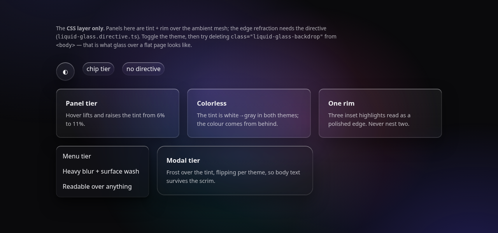
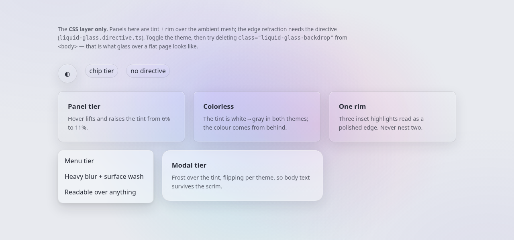

# Liquid Glass — a Claude Code skill

Apple-style frosted, **refracting** surfaces: a CSS layer that paints the tint and rim, and an SVG displacement filter that bends the backdrop through the panel's edge the way real glass does.

Most "glassmorphism" recipes are `backdrop-filter: blur()` plus a white overlay, which reads as a blurred rectangle. This skill carries the other half — the refraction — plus the handful of rules that decide whether glass looks like glass or like a gray box. Every rule here came from a UI that looked wrong before it looked right.




Both shots are `assets/demo.html` rendered as-is — the CSS layer alone, no refraction, which is also the fallback every non-Chromium browser gets. The colour in the panels is the ambient backdrop showing through; the tint itself is colorless.

## Install

This repo is a Claude Code plugin marketplace. In Claude Code:

```
/plugin marketplace add stormaref/LiquidGlassSkill
/plugin install liquid-glass@stormaref-skills
```

Then ask for glass in your own words. The skill is model-invoked: "make this card frosted glass", "add glassmorphism to the sidebar", "the glass panel looks flat" all reach it. To run it by hand it is namespaced under the plugin — `/liquid-glass:liquid-glass`.

Prefer a plain skill directory with no plugin machinery? Copy the skill folder out:

```bash
git clone --depth 1 https://github.com/stormaref/LiquidGlassSkill.git /tmp/lgs
cp -r /tmp/lgs/plugins/liquid-glass/skills/liquid-glass ~/.claude/skills/
```

## What's in it

The skill lives at `plugins/liquid-glass/skills/liquid-glass/`; paths below are relative to it.

| File | |
|---|---|
| `SKILL.md` | The skill: the two-layer model, four rules, the tier table, and a checklist |
| `assets/liquid-glass.css` | Drop-in CSS — its own tokens, light and dark, no dependencies |
| `assets/liquid-glass.directive.ts` | The refraction layer, as an Angular directive |
| `assets/demo.html` | Self-contained page for the CSS layer. Open it in a browser |
| `references/refraction.md` | The mechanism and the formulas — enough to port the directive to any framework |
| `references/recipes.md` | Variants (card, FAB, modal, dropdown, circular control) and the pitfalls behind each rule |

## Using it without Claude

`assets/liquid-glass.css` is a plain stylesheet: link it, put `liquid-glass-backdrop` on the page shell, `liquid-glass` on panels. Angular projects can import the directive as-is. Everything else: `references/refraction.md` is a complete porting spec — or point a Claude session at it and ask.

Two things to know before you start:

- **The backdrop is required.** Glass shows what is behind it; over a flat fill there is nothing to show. Build the ambient mesh first and check the page looks uneven with no glass on it.
- **Refraction is Chromium-only**, and cannot be feature-detected (Safari parses `backdrop-filter: url(#…)` and paints nothing). Everywhere else the stylesheet's blur fallback carries the look. The directive gates on engine and stays inert.

## Attribution

The refraction field is a port of the fragment shader in **[liquid-glass-js](https://github.com/dashersw/liquid-glass-js)** by Armagan Amcalar (MIT). This port targets an SVG displacement filter fed by the *live* backdrop rather than the library's html2canvas page snapshot, so it tracks scrolling, theme changes and content updates for free. The upstream notice sits at the top of `assets/liquid-glass.directive.ts` — keep it there on any copy or port.

Extracted from a production Angular app where this is the primary surface treatment: cards, topbars, dialogs, menus and the task board all sit on it.
